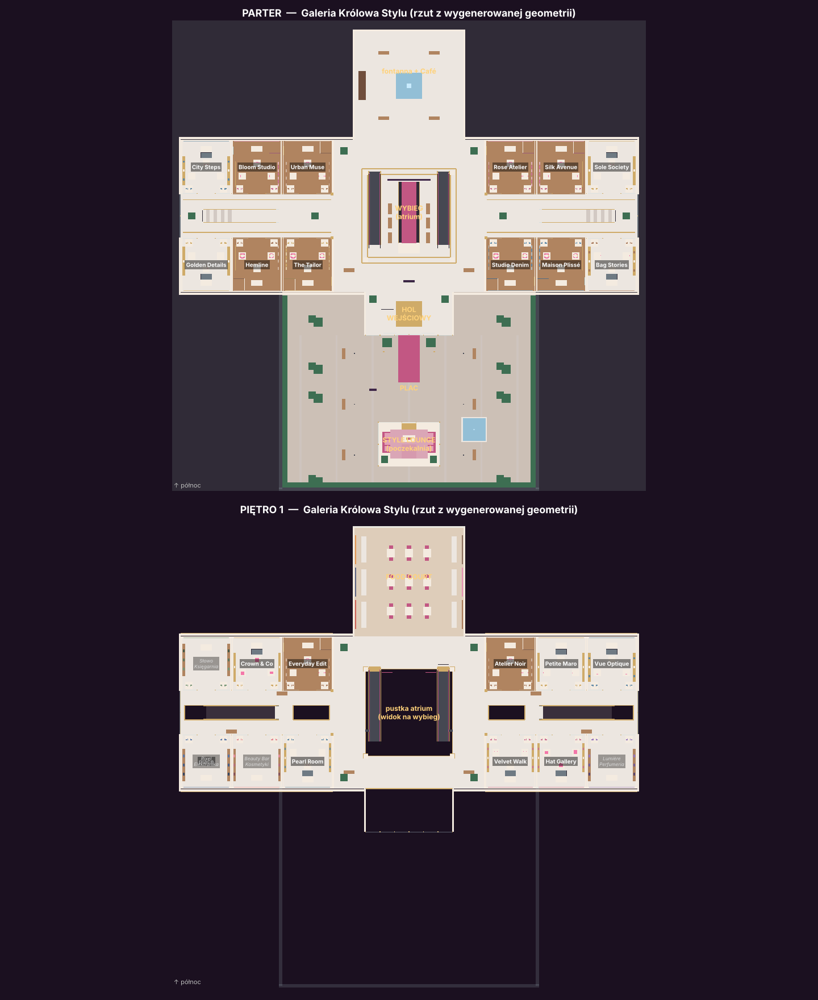

# Królowa Stylu — galeria mody multiplayer

Dwa tematy, wspólny budżet 1500 zł i 8 minut na dwie stylizacje. Wystarczy **jeden prawdziwy gracz**: wolne miejsca do czterech uczestniczek zajmują boty. Uczestniczki robią zakupy w dwupiętrowej galerii, prezentują oba zestawy na wybiegu i oceniają pozostałe w skali 1–10.



## Uruchomienie

1. Zatrzymaj Play w Studio. W folderze repozytorium wykonaj `git pull`.
2. Uruchom `rojo serve` (Rojo 7.7.1 z `aftman.toml`) lub pozostaw działający serwer. Połącz wtyczkę w Studio i poczekaj na synchronizację.
3. Otwórz kopię `Roblox Shopping queen.rbxl`. Projekt synchronizuje skrypty, zachowując istniejącą mapę. Galeria powstaje po Play.
4. Uruchom **Play nawet jednym klientem**. W Style Lounge podejdź do szklanych drzwi i naciśnij **E („Wejdź do gry”)** albo kliknij duży przycisk **✨ WEJDŹ DO GRY** na dole ekranu. Po 5 sekundach staniesz na placu przed galerią; automatyczne drzwi otworzą się, gdy podejdziesz.

Alternatywnie `rojo build -o "Ola Roblox.rbxlx"` tworzy miejsce ze skryptami, które generują galerię. Build nie importuje mapy z oryginalnego pliku `.rbxl`. Oryginał pozostaje bez zmian. Zapis i publikacja gry do Roblox należą do właściciela.

## Galeria

Generator zarządza wyłącznie `Workspace.ShoppingQueenPrototype` (~2800 części). Parter jest na wysokości 8 studów nad oryginalną płytą, piętro 20 studów wyżej, dach na wysokości 48.

- **Plac i poczekalnia** — wybrukowany plac z drzewami, latarniami, ławkami i fontanną. Przeszklony Style Lounge stoi naprzeciw wejścia. Niewidzialne ściany i żywopłot zamykają plac.
- **Wejście** — dwukondygnacyjna szklana fasada z neonowym szyldem, zadaszeniem, czerwonym chodnikiem i **automatycznymi drzwiami przesuwnymi**, które otwierają się przed graczami i botami. W holu stoi punkt informacji.
- **Atrium** — centralne, dwupiętrowe, ze szklaną latarnią dachową. Na parterze jest wybieg z widownią i reflektorami, a z galerii na piętrze widać pokaz. Piętra łączą dwa **ruchome schody** (jedne w górę, drugie w dół), kolumny, szklane balustrady, żyrandole, banery i dwustronna tablica z listą sklepów.
- **Skrzydło Różane (wschód) i Skrzydło Złote (zachód)** — korytarze z pustką na całą wysokość, kładki na piętrze, **schody** w każdym skrzydle, przeszklone zakończenia i świetliki w dachu. Po trzy lokale na każdej stronie korytarza i na każdym piętrze.
- **Północ** — na parterze fontanna i Café Royale. Na piętrze **food court** z sześcioma stoiskami (pizza, sushi, burgery, kebab, lody, kawa), stolikami i panoramicznym oknem. Przy stoisku można „zamówić” posiłek; to tylko efekt, budżet się nie zmienia.

| Parter | Lokale |
| --- | --- |
| Skrzydło Różane | Rose Atelier, Silk Avenue, Studio Denim, Maison Plissé, Sole Society, Bag Stories |
| Skrzydło Złote | Urban Muse, Bloom Studio, The Tailor, Hemline, City Steps, Golden Details |

| Piętro 1 | Lokale |
| --- | --- |
| Skrzydło Różane | Atelier Noir, Velvet Walk, Petite Maro, Hat Gallery, Vue Optique, *Lumière (perfumeria)* |
| Skrzydło Złote | Everyday Edit, Pearl Room, Crown & Co, *Beauty Bar, Słowo (księgarnia), Pixel (elektronika)* |

Lokale kursywą są dekoracyjne: mają wystrój, ale nic w nich nie sprzedajemy. Każdy butik ma szklaną witrynę z manekinami, szyld, neon, oświetlenie oraz trzy aktualne produkty. Sklepy z ubraniami mają wieszaki, przymierzalnię i lustro, a sklepy z dodatkami półki i gablotę.

**Oferta jest losowana na początku każdej rundy.** Każdy lokal ma trzy produkty z puli swojej kategorii (8–12 przedmiotów), łącznie 60 ofert z 66 przedmiotów. Każdy sklep zmienia co najmniej jeden fason względem poprzedniej rundy. Wszyscy widzą tę samą ofertę i ceny. Kupować i przymierzać można tylko wewnątrz sklepu lub tuż przed jego wejściem, na tym samym piętrze.

## Tryb z botami

Start jest dobrowolny: sama obecność w salonie nie zapisuje do rundy. Po pierwszym zgłoszeniu trwa 5-sekundowe odliczanie, podczas którego mogą zapisać się inni. Jedna osoba gra z trzema botami, dwie z dwoma, trzy z jednym. Od czterech graczy boty nie są potrzebne; limit to 8 prawdziwych graczy. Kto zapisze się w trakcie rundy, zagra w następnej. Po wynikach trzeba ponownie użyć wejścia.

Boty są oznaczone **[BOT]**, mają własne postacie R15 z fryzurami i animacją chodu. Startują w holu, chodzą po galerii z pathfindingiem (także po schodach). Jeśli utkną, przenoszą się do celu. Kupują z bieżącej kolekcji przez te same reguły cen, budżetu (1500 zł) i kolorów co gracze. Najpierw kompletują górę i dół obu zestawów, potem dodatki, i zapisują obie stylizacje. Po skończonych zakupach odpoczywają w food court. Po upływie 8 minut nie kupują już niczego.

Boty prezentują oba zestawy i głosują raz na pokaz, nigdy na siebie. Oceny są **symulowane**: 6–10 za kompletny zapisany zestaw (z bonusem za dużo dodatków), 1–4 za brak zapisu. Nie analizują zgodności z tematem. Gracz może oceniać boty, a ranking zawiera wszystkich aktywnych uczestników. Runda trwa, dopóki jest w niej przynajmniej jeden prawdziwy gracz. Gdy wyjdzie ostatni, runda zostaje anulowana, a boty usunięte.

## Zakupy, stylizacje i przebieg rundy

- **Sklepy** w dolnym menu otwierają mapę galerii z podziałem na piętra. Wybierz sklep i „Oferta”, albo podejdź do lady lub manekina i użyj E.
- **Podgląd** pokazuje miniaturkę prawdziwego produktu; na awatarze R6 obracany podgląd uproszczonej wersji z wyborem 6 kolorów.
- **Przymierz na postaci** zakłada produkt, ale nie zmienia budżetu ani zestawu. **Zakończ przymiarkę** przywraca aktualny zestaw.
- Kup produkt, dodaj go do zestawu 1 lub 2 i zapisz. Każdy zestaw wymaga góry i dołu. Dodatki (buty, nakrycie głowy, torebka, biżuteria, okulary) można łączyć.
- Pokazy: każda uczestniczka prezentuje zestaw 1, potem wszystkie zestaw 2; na ocenę jest 15 sekund. Wynik to średnia z dwóch pokazów, remisy dają wspólne miejsca. Wyniki są widoczne przez 20 sekund.

## Prawdziwe ubrania z katalogu Roblox

Asortyment to **66 prawdziwych przedmiotów z katalogu Roblox** (`Mall.Pools`):
- 12 gór: bluzki, swetry, trencz, ramoneska, kurtka jeansowa, płaszcz;
- 10 dołów: spódnice z falbaną, szyfonowe, tenisowa, spodnie, szorty;
- 10 par butów;
- 9 nakryć głowy: berety, kapelusze, tiary;
- 9 torebek;
- 8 sztuk biżuterii;
- 8 par okularów.

Ubrania, buty i okulary są w większości dziełem samego Robloxa (layered clothing). Torebki, biżuteria i część kapeluszy to popularne przedmioty twórców UGC. Nikt nie musi ich posiadać: gra zakłada je przez `HumanoidDescription`, tak jak gry typu avatar editor. Nic nie trzeba uploadować.

- **Awatary R15 i boty** noszą prawdziwe przedmioty. Zakupiony element zastępuje to, co postać miała w tym samym miejscu (np. własną koszulkę lub kapelusz). Włosy, twarz i kolor skóry zostają.
- **Manekiny w sklepach** stoją w prawdziwych ubraniach. Karty produktów i podgląd pokazują oficjalne miniaturki z katalogu (`rbxthumb://`).
- Przedmioty z katalogu mają **oryginalny kolor**, więc wybór koloru dotyczy tylko wersji uproszczonej.
- **Awatary R6** (ubrania warstwowe działają tylko na R15) i przedmioty, które zniknęłyby z katalogu, dostają wbudowane modele z części. Serwer sprawdza wszystkie ID przy starcie (`Appearance.validate`).

Aby dodać lub wymienić przedmiot, dopisz w `Mall.Pools` wpis `{ klucz, nazwa, cena, styl zapasowy, { A(assetId, "TypAkcesorium") } }`. Typy: Shirt, TShirt, Sweater, Jacket, Pants, Shorts, DressSkirt, Hat, Face, Neck, Front, Shoulder; buty to `shoes(lewy, prawy)` + ID paczki.

## GUI i muzyka

Interfejs ma ciemny, „butikowy” motyw: półprzezroczyste panele, różowo-fioletowe gradienty, złote akcenty i fonty Montserrat oraz Builder Sans. Tekst ma co najmniej 12–14 px. Elementy:

- **HUD** z fazą, budżetem, zegarem i tematami;
- **lista uczestniczek** z oznaczeniem botów i aktualnie prezentującej osoby;
- pulsujący przycisk **Wejdź do gry**;
- **dock** z ikonami: Salon, Sklepy/Oceny, Butik +, Zasady, Muzyka;
- karty produktów w siatce z ceną, statusem i kolorem.

Skróty: M — Salon, B — Butik +, Esc — zamknij okno.

Muzyka gra lokalnie i zmienia się z fazą gry: spokojna w poczekalni, rytmiczna podczas zakupów, „catwalkowa” na pokazie, radosna przy wynikach. Przycisk **🔊 Muzyka** ją wycisza. Utwory pochodzą z licencjonowanej biblioteki **APM Music** udostępnionej przez Roblox (konto APMOfficial), więc działają w każdej grze bez ryzyka wyciszenia za prawa autorskie. Identyfikatory są w `Config.Music`.

**Butik + zawiera wyłącznie zapowiedzi dodatków.** Nie ma cen, produktów płatnych ani okien płatności.

## Kod i testy

- `src/shared/Mall.luau`: lokale, rozmieszczenie, 66 przedmiotów z katalogu i losowanie oferty.
- `src/shared/BotLogic.luau`: plan zakupów botów i symulowane oceny (czysta logika, testowana).
- `src/shared/Config.luau`: czas, budżet, skład rundy, imiona botów, muzyka, tematy i paleta.
- `src/shared/Garments.luau` i `Rules.luau`: zapasowe modele ubrań oraz reguły budżetu, zestawów i głosów.
- `src/server/Appearance.luau`: zakładanie przedmiotów z katalogu, manekiny i walidacja ID.
- `src/server/World.luau`: generator galerii, automatyczne drzwi, wymiana ekspozycji.
- `src/server/BotActors.luau`: postacie botów, chodzenie i animacje.
- `src/server/init.server.luau`: zapisy, przebieg rundy, boty, pokazy i wyniki.
- `src/client/UI.luau`, `Music.luau` i `init.client.luau`: wygląd, muzyka i interakcje GUI.

```sh
luau tests/rules.luau
luau tests/ui_state.luau
luau tests/mall.luau
luau tests/bots.luau
python tests/check_world.py
rojo build -o "Ola Roblox.rbxlx"
```

`check_world.py` wymaga Pythona 3 oraz `luau` w PATH lub zmiennej `LUAU_BIN`. Sprawdza generator na uproszczonych obiektach silnika (z pełną matematyką CFrame):

- podłogi na obu piętrach i otwarte pustki;
- trasę: plac → automatyczne drzwi (zamknięte, otwarte, znów zamknięte) → hol → atrium → skrzydła i food court;
- wolne wejście do każdego z 20 sklepów oraz zasięg zakupu ograniczony do jednego sklepu i jednego piętra;
- 87 interakcji, ruchome schody i schody;
- szczelny salon i odświeżanie ekspozycji;
- modele zapasowe wszystkich 66 przedmiotów na R6/R15.

`bots.luau` odtwarza 300 planów zakupowych botów przez prawdziwe reguły. Testy nie uruchamiają silnika Roblox: renderowanie, fizykę, pathfinding i animacje trzeba sprawdzić w Studio.

### Kontrola ręczna w Studio

1. Jednym klientem: wejście drzwiami i przyciskiem, 5 s odliczania, przeniesienie z kanapy, automatyczne drzwi, 1500 zł i 8 minut. Powinny pojawić się trzy postacie [BOT].
2. Sprawdź ruchome schody i schody w obu kierunkach, kładki, balustrady i food court. Sprawdź, czy boty dochodzą do sklepów na obu piętrach i kompletują zestawy.
3. Sprawdź manekiny i miniaturki z katalogu, przymiarkę i noszenie prawdziwych ubrań (R15) oraz wersję uproszczoną na awatarze R6. Zakup z daleka, z innego piętra lub w niewłaściwym sklepie ma być odrzucony. Przetestuj przymiarkę, kolory, dwa zapisane zestawy i reset postaci.
4. Przejdź pełną rundę: pokazy botów i gracza, głosowanie, ranking i powrót do salonu. W następnej rundzie oferta ma się zmienić, a stare boty zniknąć.
5. Drugim klientem sprawdź zapis w trakcie odliczania i zapis na następną rundę.
6. Sprawdź muzykę i jej wyciszanie, czytelność GUI na telefonie (emulator) oraz klatkaż w całej galerii.

Po aktualizacji zatrzymaj Play, poczekaj na Rojo i uruchom Play ponownie.
